# Integration of Black Widow's Thoughts into Dung Beetle Optimization Algorithm, MATLAB Code

This issue article reproduces an improved version of the Dung Beetle algorithm, published on May 8th, 2024.
The paper cites as follows:
[1] Kong Lingsong, Shi Qie, Sun Hao, et al. Integration of Black Widow Thoughts into Beetle Optimization Algorithm [J/OL]. Microelectronics and Computer, 1-15 [2024-05-09].
The principle of the improved ant optimization algorithm is as follows:
Improvement strategy
Improvement point 1: Application of ICMIC chaotic mapping strategy in population initialization
Population initialization is randomly generated in DBO, which may lead to an uneven distribution of the population. Applying the ICMIC chaotic mapping strategy to the initialization of the Dung Beetle population can enhance its diversity.
ICMIC chaotic mapping formula is as follows:
\n        \n  
Improvement point 2: Integrate the Black Widow algorithm concept into the rolling ball phase.
In the basic Dung Beetle Algorithm, due to the influence of the best position on the upper and lower bounds for the egg-laying moth, small moth, and thief moth, respectively, and the fact that the upper bound gradually decreases with increasing iterations while the lower bound increases, the range of movement for these three types of moths is gradually reduced, mainly serving as a local exploitation mechanism. Therefore, the global search in the Dung Beetle Algorithm is primarily achieved through the rolling and dancing behaviors of the Dung Beetle. However, in the rolling behavior, the Dung Beetle relies solely on the worst-case global value, lacking connections with other individual populations, which can lead to low global search capabilities and issues such as slow convergence and the need for more iterations. To address this, this paper proposes using the Black Widow algorithm to replace the rolling behavior algorithm. The Black Widow algorithm transforms the movement model of the Black Widow spider in a web into both linear and spiral forms, with the position update formula being as follows:
\n        \n  
Among them, x* is the optimal position, m is a random floating-point number between 0.4 and 0.9, β is a random floating-point number between -1 and 1, and xr1 are other individuals in the population. 
Pheromone is another characteristic of the Black Widow swarm, playing an important role in the mating process. The robust and mature female spider releases a strong pheromone, indicating that it is a strong reproductive object. Therefore, male spiders can choose suitable partners based solely on pheromones, reducing the cost of reproduction. On the other hand, female spiders with low pheromones will be eliminated by the population, and the Black Widow algorithm defines pheromone as follows:
\n        \n  
In this context, fitnessmax represents the global optimal individual's fitness, which is the global optimum value. Fitnessmin denotes the global worst individual's fitness, which is the global worst value. Fitness(i) stands for the current individual's fitness. When pheromone levels are low, individuals will be replaced by new ones, with the position update formula being:
\n        \n  
Among them, xr1 and xr2 are two different individuals in the population.
Improvement point 3: Adaptive T-distribution improvement factor
The t-distribution is a student distribution, with decision parameter m, and its probability density function is:
\n        \n  
Adaptive t-distribution perturbation factor has Cauchy Two characteristics of Gaussian distribution. Ensures the dung beetle algorithm has good global exploration capability in the early stages of iteration.,  Good local exploration ability in the later stage of iteration. And improve the convergence speed of the algorithm. The specific location update method is as follows:
\n        \n  
Among them, t represents the random numbers under the t-distribution.  
Results display  
The results are tested on the CEC2005 function set and compared with the subtraction optimizer (SABO), whale algorithm (WOA), Harris Hawk Optimizer (HHO), Northern Eagle Optimizer (NGO), Grey Wolf Optimizer (GWO), and Original Dung Beetle Bee Optimizer (DBO).  
Tested in CEC2005:
\n        \n      \n        \n      \n        \n      \n        \n      \n        \n      \n        \n  
Ablation Experiments
To verify the effectiveness of different improvement strategies proposed in the article, three algorithms were obtained by combining DBO with the aforementioned three strategies:
1) DBO1 was obtained by adding chaos mapping to DBO;
2) DBO2 was obtained by replacing the rolling behavior of the Black Widow with that of the Dung Beetle Bee;
3) DBO3 was obtained by adding an adaptive distribution improvement factor to DBO.
At the same time, two pairs of improvement strategies were combined to obtain DBO1+2 and DBO1+3. The results are as follows:
\n        \n  
\n        \n      \n        \n      \n        \n      \n        \n      \n        \n  
Overall, the results are quite impressive; each strategy has effectively achieved its intended effect.

## Images

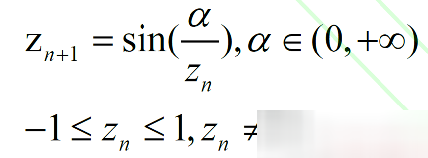
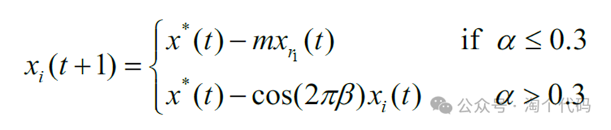
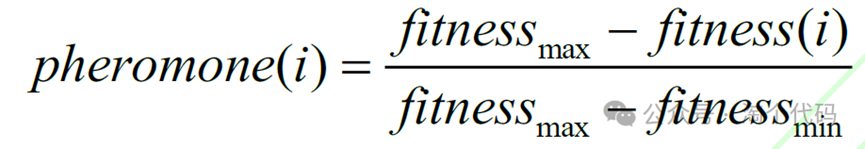
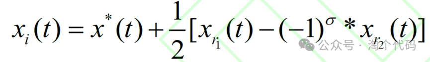
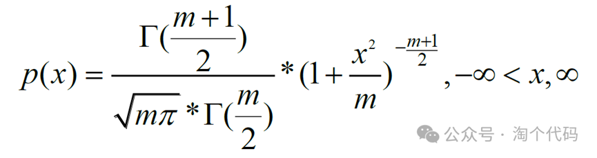
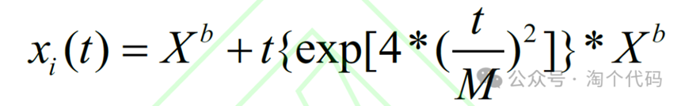
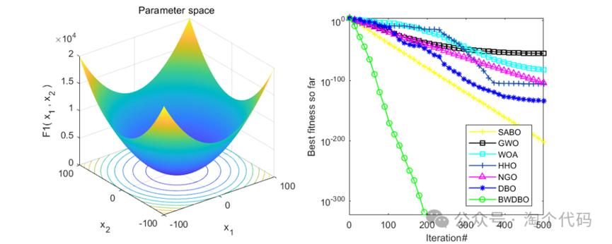
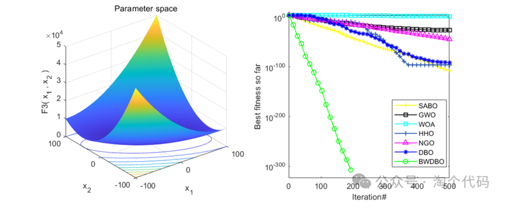
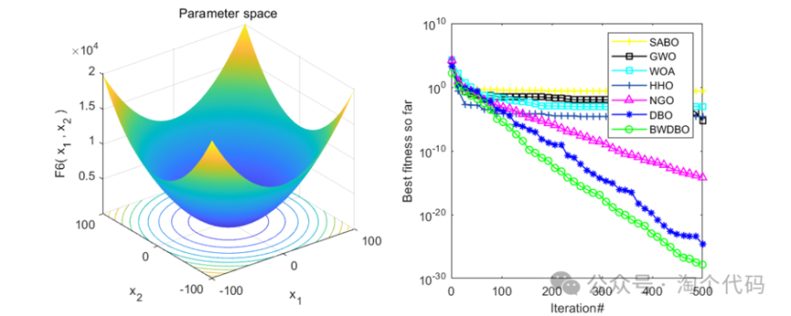
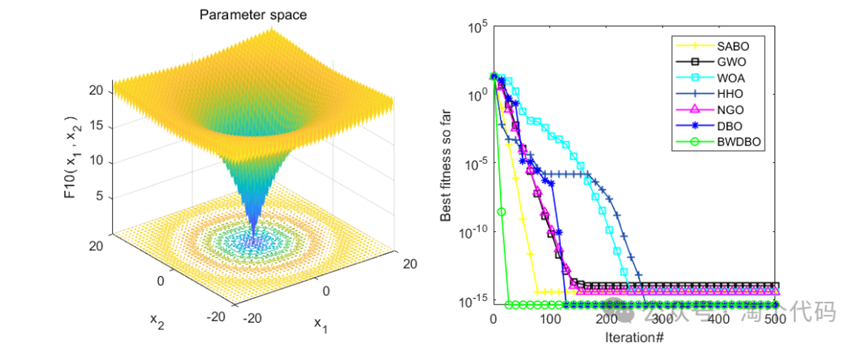
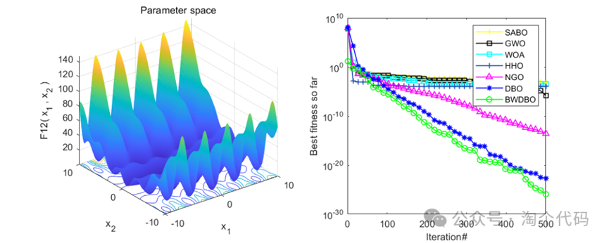
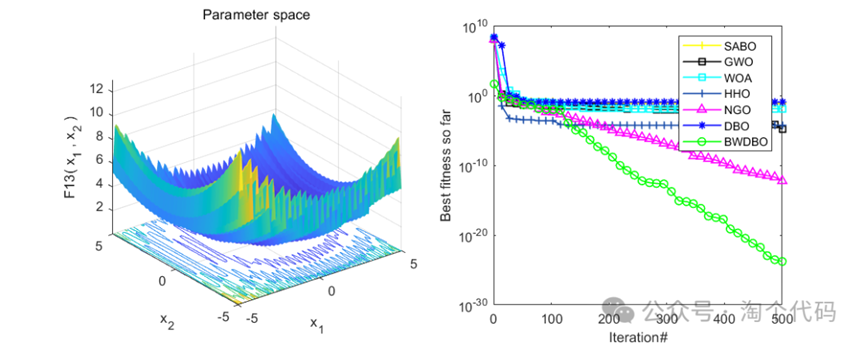
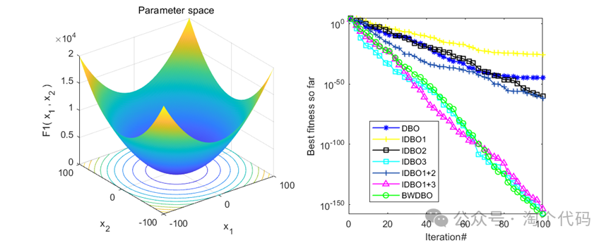
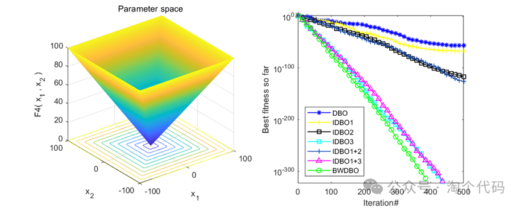
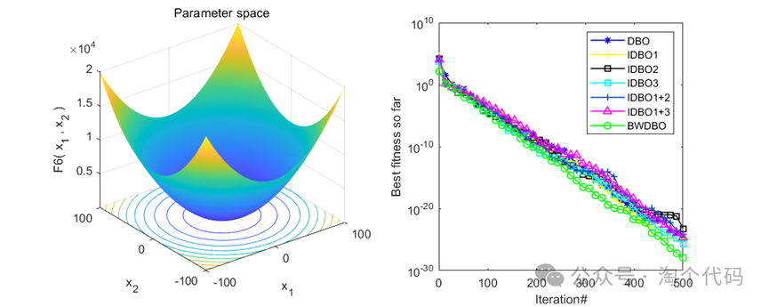
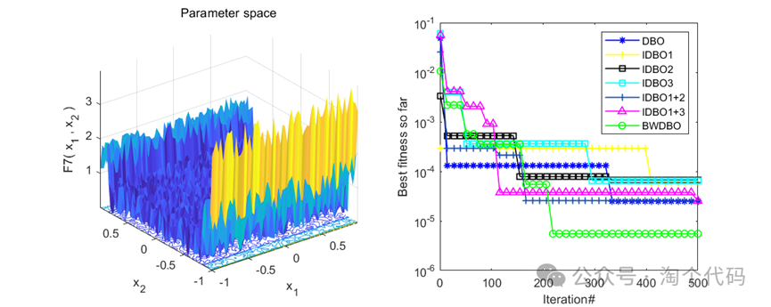
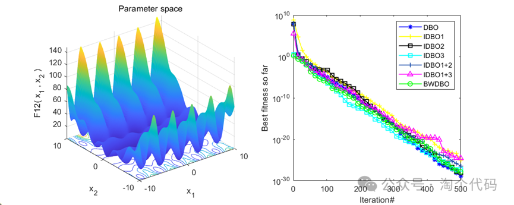
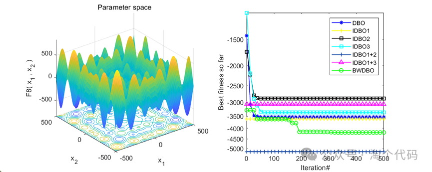

<!-- PAYMENT_BLOCK -->

## Get this dataset

- Payment link (Stripe): [Buy now](https://buy.stripe.com/3cs8yP7sY87d0vu9AB)
- Payment QR code: 

<!-- /PAYMENT_BLOCK -->
